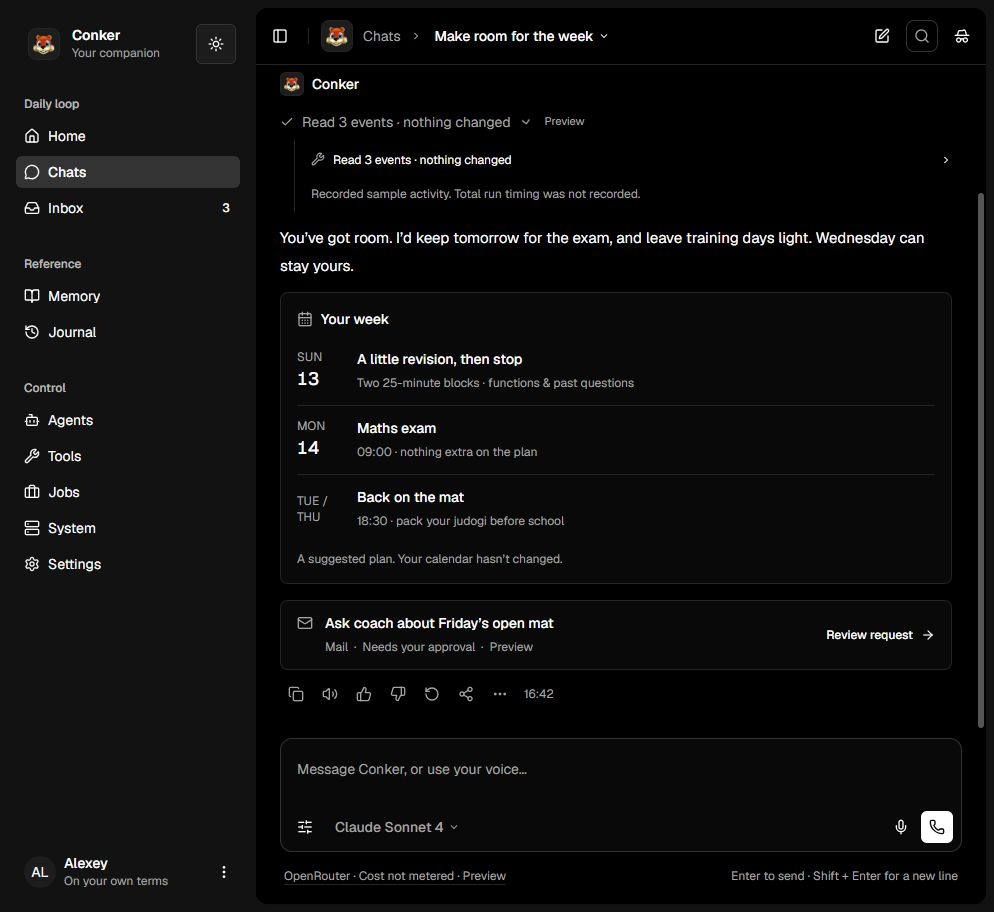
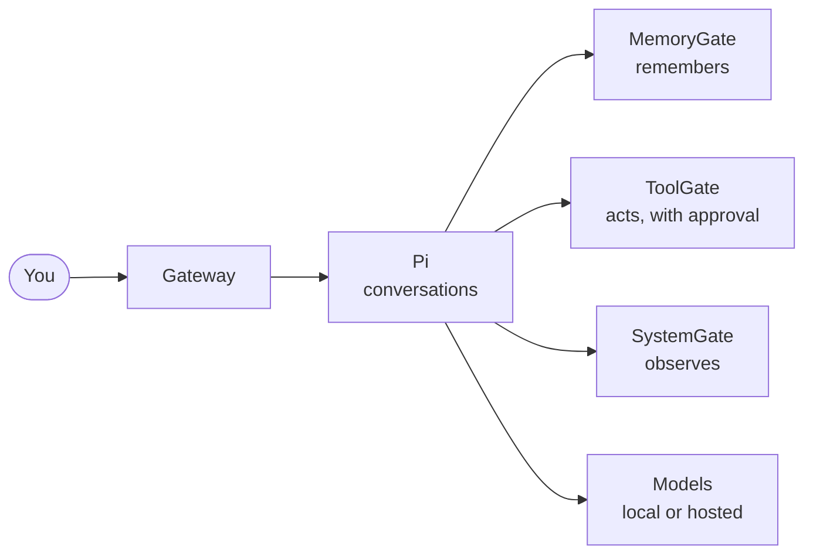

<p align="center"></p>
<h1 align="center">Conker</h1>
<p align="center"><b>A personal AI companion you host yourself.</b><br/>
Talk to it, choose what it remembers, and review what it does.</p>
<p align="center">
  <a href="docs/1-overview.md">Overview</a> ·
  <a href="docs/2-how-it-works.md">How it works</a> ·
  <a href="docs/3-using.md">Using it</a> ·
  <a href="docs/4-running.md">Running it</a> ·
  <a href="docs/status.md">Status</a>
</p>
<p align="center">
  <a href="https://github.com/Conker-AI/conker/actions/workflows/ci.yml"></a>
  <a href="https://github.com/Conker-AI/conker/actions/workflows/dashboard.yml"></a>
  <a href="LICENSE"></a>
  
</p>



## What it does

- **Talk and think separately.** Keep chatting while an optional thinking model analyzes a request in the background.
- **Choose models by job.** Use a fixed talking model or configure Auto; give thinking and other roles their own models.
- **Keep continuity.** Reopen saved chats and drafts, inspect memory sources, and check what was actually delivered to memory.
- **Control actions.** Conker tools run through ToolGate's grants and approval policy. Required approvals apply to one exact action.
- **Run locally.** Host the app and local models yourself, or explicitly connect a hosted provider or subscription runtime.

> **Status:** early. The current source has 41 of 42 tracked capability families active;
> the production owner terminal remains deferred. The current tree still needs
> assembled Linux release acceptance before rollout. [Full status](docs/status.md)

## Try it locally

For the connected chat workspace in this branch, with real local
conversations, memory and workflow services, follow
[Connected workspace](docs/connected-workspace.md). Research and reconciled
requirements are recorded in [the source review](docs/conker-research-2026-10-09.md).

With Python 3.12, Node.js 22.12+, Docker and Ollama running:

```sh
ollama pull qwen2.5:3b
python scripts/workspace.py install --model qwen2.5:3b
python scripts/workspace.py up
```

Open https://localhost:18550. The private initial password is in
`.local-run/gateway/initial-owner-password.txt`. The [run guide](docs/connected-workspace.md)
describes stopping, rebuilding, password recovery and local-profile limitations.
The optional [enhanced profile](docs/harnesses-and-models-2026-10-09.md)
adds Laya routing, separate background thinking and native subscription sign-in.
Connecting a provider does not select a model or prove that it can answer.

For a separate interface preview with demo data and no server, use Node.js 22.12 or newer:

```sh
git clone https://github.com/Conker-AI/conker.git
cd conker/dashboard
npm ci
npm run dev -- --host localhost --port 5173 --strictPort
```

Open http://localhost:5173 and start chatting. Answers, memories and approvals are simulated in the
browser; ask it to email someone to see an approval. To run the real thing on a server, see
[4 · Running Conker](docs/4-running.md).

## How it's built



Small services with their own repositories and standalone operation:
[pi](https://github.com/Conker-AI/pi) ·
[memorygate](https://github.com/Conker-AI/memorygate) ·
[toolgate](https://github.com/Conker-AI/toolgate) ·
[systemgate](https://github.com/Conker-AI/systemgate) ·
[embeddings](https://github.com/Conker-AI/embeddings).
More in [2 · How it works](docs/2-how-it-works.md).

## Docs

| | |
|---|---|
| [1 · Overview](docs/1-overview.md) | What Conker is, why, and the 10 words it uses |
| [2 · How it works](docs/2-how-it-works.md) | Diagrams: services, one message, one approval |
| [3 · Using Conker](docs/3-using.md) | Each screen and common tasks |
| [4 · Running Conker](docs/4-running.md) | Preview, server, local Windows stack |
| [5 · Developing](docs/5-developing.md) | Repos, checks, rules, decisions |
| [Status](docs/status.md) | What works today, and what doesn't |

## Credits

The frontend builds on [shadcnstore's dashboard template](https://github.com/shadcnstore/shadcn-dashboard-landing-template)
([notice](dashboard/THIRD_PARTY_LICENSES/shadcn-dashboard-template.txt)), React, Vite, Tailwind CSS
and Radix.

## License and security

[AGPL-3.0](LICENSE), version 3 only. Copyright (C) 2026 alexeybe1kin. Releases published before 24 October 2026 were under MIT and stay under MIT. Found a vulnerability? Please report it privately: [security policy](SECURITY.md).
