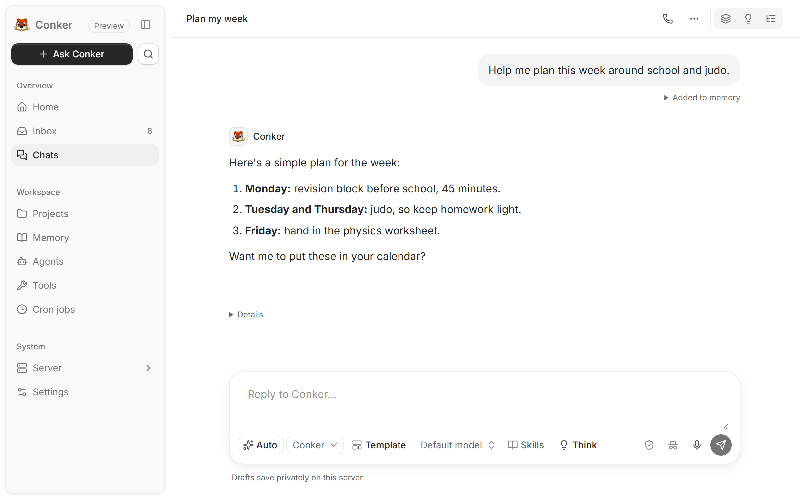
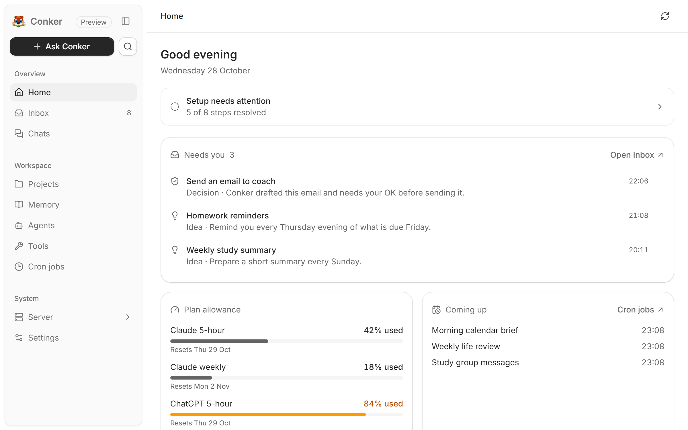
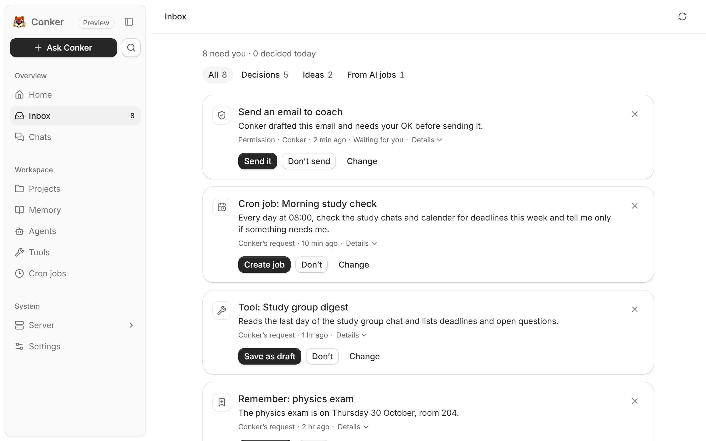
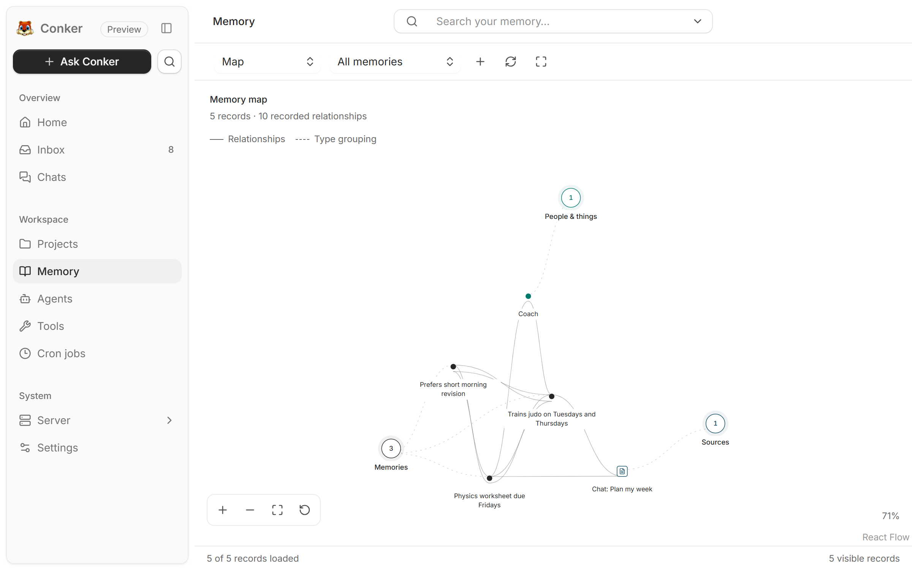
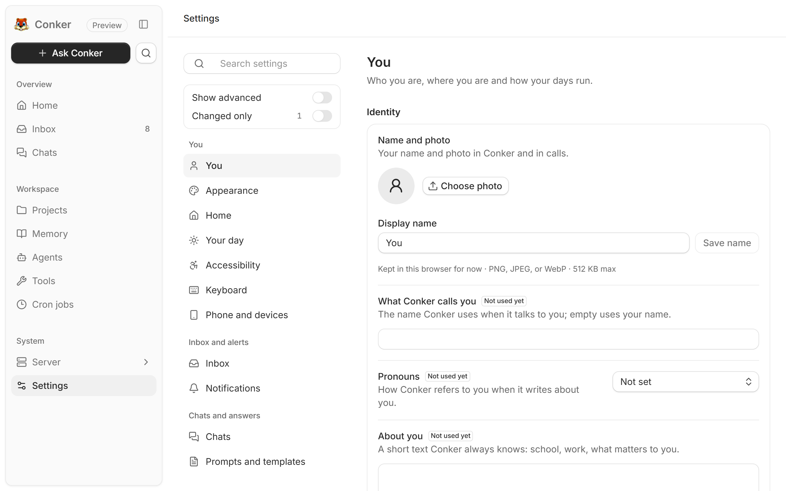
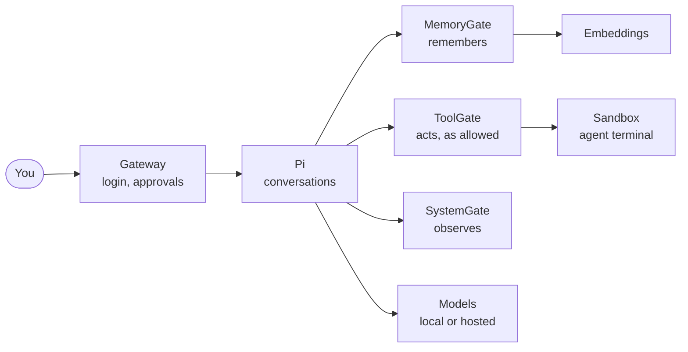

<p align="center"></p>
<h1 align="center">Conker</h1>
<p align="center"><b>A personal AI companion you host yourself.</b><br/>
It remembers you, shows its work, and never acts without your say.</p>
<p align="center">
  <a href="docs/1-overview.md">Overview</a> ·
  <a href="docs/2-how-it-works.md">How it works</a> ·
  <a href="docs/3-using.md">Using it</a> ·
  <a href="docs/4-running.md">Running it</a> ·
  <a href="docs/status.md">Status</a>
</p>
<p align="center">
  <a href="https://github.com/Conker-AI/conker/actions/workflows/ci.yml"></a>
  <a href="https://github.com/Conker-AI/conker/actions/workflows/dashboard.yml"></a>
  <a href="LICENSE"></a>
  
</p>

<picture>
  <source media="(prefers-color-scheme: dark)" srcset="docs/images/chat-dark.png" />
  
</picture>

## What it does

- **Talk to the models you choose.** Local models through Ollama, hosted ones through OpenRouter,
  OpenAI or Anthropic, or sign in with a ChatGPT or Claude plan. Answering, thinking and reviewing each get
  their own model, or let Auto pick.
- **Remembers, with sources.** Every memory keeps where it came from. Correct or forget any of
  them from the Memory screen.
- **Acts only as you allow.** Every action goes through ToolGate. Your settings decide, per chat,
  agent and tool, whether it runs, the AI reviewer decides, or you are asked. When the reviewer
  decides, anything that reaches a real person or can't be undone still comes to you.
- **One Inbox.** Approvals, Conker's own requests (a cron job, a tool, a memory) and its ideas wait
  in one place, one card each: do it, don't, or change it.
- **Works while you're away.** Cron jobs are your own instructions, run by the AI with tools on a
  schedule, an event or a webhook, within the budgets you set.
- **A terminal for agents, not for your server.** Each command runs in a fresh locked-down
  container with no network; packages arrive only through a read-only proxy.
- **Everything is a setting.** 401 settings in 31 topics, one pattern, searchable. The same
  settings work from the terminal with `conker config`.

## A look around

<table>
  <tr>
    <td width="50%"><picture><source media="(prefers-color-scheme: dark)" srcset="docs/images/home-dark.png" /></picture><br/><sub><b>Home.</b> What needs you, what's coming up, how much of each plan is left.</sub></td>
    <td width="50%"><picture><source media="(prefers-color-scheme: dark)" srcset="docs/images/inbox-dark.png" /></picture><br/><sub><b>Inbox.</b> One card per decision, with the buttons that fit it.</sub></td>
  </tr>
  <tr>
    <td width="50%"><picture><source media="(prefers-color-scheme: dark)" srcset="docs/images/memory-dark.png" /></picture><br/><sub><b>Memory.</b> What Conker knows, and the chat each fact came from.</sub></td>
    <td width="50%"><picture><source media="(prefers-color-scheme: dark)" srcset="docs/images/settings-dark.png" /></picture><br/><sub><b>Settings.</b> Every setting by topic, in one pattern.</sub></td>
  </tr>
</table>

<sub>Screenshots show the built-in preview with sample data.</sub>

## Get started

**Install on a server.** Any Linux machine with Docker (WSL2 works too). 16 GB of RAM is
comfortable for local models.

```sh
git clone https://github.com/Conker-AI/conker.git
cd conker
./install.sh
```

The installer checks the machine, generates every secret, pulls the pinned images and prints one
address. It then offers `./conker setup`, a guided first run that asks one plain question at a
time. Day to day:

```sh
./conker status          # is everything working, and what isn't
./conker update          # a pinned release, verified, with rollback
./conker config list     # every setting, from the terminal
./conker backup          # a verified snapshot
```

**Just look around.** The interface runs on its own with sample data. Needs Node.js 22.12+.

```sh
cd conker/dashboard
npm ci
npm run dev -- --host localhost --port 5173 --strictPort
```

Open http://localhost:5173. Answers, memories and approvals are simulated in the browser.

Other ways to run it, including a native development stack on Windows and the source-built
Ubuntu layout: [4 · Running Conker](docs/4-running.md).

## Status

Conker is early. The current source has 43 of 44 tracked capability families active; the
owner's own terminal is still deferred. Local models on a CPU work but are slow; a hosted or larger
model makes tool use and drafts much more reliable. [What works today](docs/status.md)

## How it's built

Small services with one job each, so every boundary is a process boundary. Each has its own
repository and runs on its own.



| Repository | Job | Release |
|---|---|---|
| [**pi**](https://github.com/Conker-AI/pi) | Conversations, model roles, the gateway and a record of every turn | <a href="https://github.com/Conker-AI/pi/tags"></a> |
| [**toolgate**](https://github.com/Conker-AI/toolgate) | The only way to act: typed tools, exact approvals, spending limits, the sandbox | <a href="https://github.com/Conker-AI/toolgate/tags"></a> |
| [**memorygate**](https://github.com/Conker-AI/memorygate) | Memory with sources: evidence in, bounded context out | <a href="https://github.com/Conker-AI/memorygate/tags"></a> |
| [**systemgate**](https://github.com/Conker-AI/systemgate) | A read-only view of the machine | <a href="https://github.com/Conker-AI/systemgate/tags"></a> |
| [**embeddings**](https://github.com/Conker-AI/embeddings) | Text to vectors, and nothing else | <a href="https://github.com/Conker-AI/embeddings/tags"></a> |

This repository holds the app, the installer, deployment and the docs. [`versions.env`](versions.env)
pins the exact release of each service. More in [2 · How it works](docs/2-how-it-works.md).

## Docs

| | |
|---|---|
| [1 · Overview](docs/1-overview.md) | What Conker is, why, and the words it uses |
| [2 · How it works](docs/2-how-it-works.md) | Services, one message, one approval, in diagrams |
| [3 · Using Conker](docs/3-using.md) | Each screen and common tasks |
| [4 · Running Conker](docs/4-running.md) | Install, update, back up, recover |
| [5 · Developing](docs/5-developing.md) | Repositories, checks, rules, decisions |
| [Status](docs/status.md) | What works today, and what doesn't yet |

## Credits

The frontend builds on [shadcnstore's dashboard template](https://github.com/shadcnstore/shadcn-dashboard-landing-template)
([notice](dashboard/THIRD_PARTY_LICENSES/shadcn-dashboard-template.txt)), React, Vite, Tailwind CSS
and Radix.

## License and security

[AGPL-3.0](LICENSE), version 3 only. Copyright (C) 2026 alexeybe1kin. Releases published before
24 October 2026 were under MIT and stay under MIT. Found a vulnerability? Please report it
privately: [security policy](SECURITY.md).
