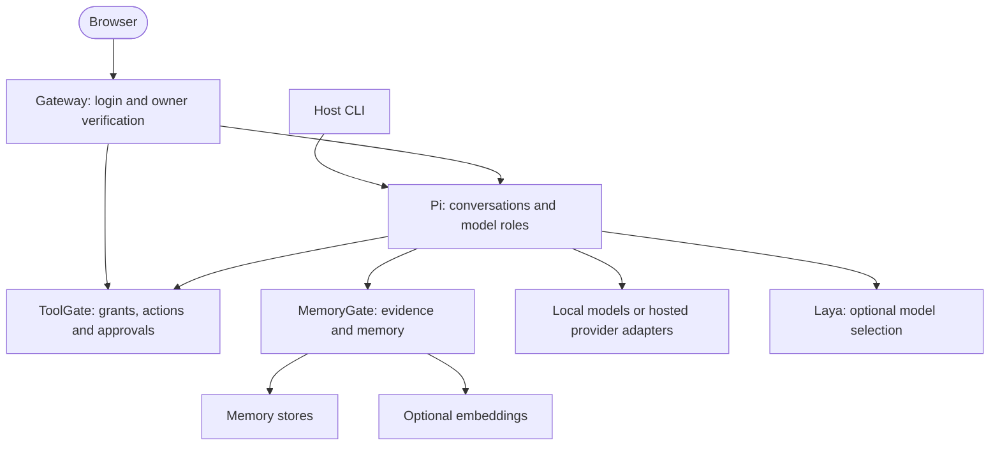

# 2 · How it works

Conker separates the conversation engine from memory, tools and provider
connections. The browser uses the authenticated Gateway. The host CLI can inspect
and operate the same service state; it is not a separate conversation store.

## The pieces

| Piece | Responsibility |
|---|---|
| **Gateway** | Browser login, authenticated requests, operation-bound owner verification and dashboard assets. Service credentials stay on the host. |
| **Pi** | Durable conversations, submissions, drafts, context, model roles and execution coordination. |
| **ToolGate** | Tool inventory, grants, workflows, approvals and execution receipts. |
| **MemoryGate** | Evidence admission, retrieval, corrections and forgetting within its configured scope. |
| **Provider runtime** | Inference and provider authentication. Subscription integrations use separate Conker-owned native runtime state. |
| **Laya decisions** | Optional selection among configured choices. It cannot grant permissions or write the talking reply. |
| **Embeddings / SystemGate / speech** | Optional semantic retrieval, read-only host observations and voice processing. Configuration and live readiness are separate. |

## A message, start to finish

1. The composer saves a private server draft and reports whether that save is
   confirmed. Sending creates a tracked submission; a lost response can be checked
   without sending the message again.
2. Pi resolves the conversation's agent, privacy, model and allowed context for
   the turn. An explicit model choice takes precedence over automatic routing.
3. When memory is enabled, Pi requests permitted memories. The turn records the
   retrieval result, including failures or an empty result.
4. The talking model answers using that context. Any Conker tool request goes
   through ToolGate. If approval is required, the turn pauses for that exact action.
5. The answer, model selection, usage and tool outcomes are recorded. Eligible
   messages have a separate memory-delivery receipt; delivery may still be pending
   after the reply finishes.

Saved turn history is kept in order. Editing a prior message creates a fork
rather than changing the old turn. Where policy permits, context compaction can
continue in a linked child chat; some contexts require explicit owner review.
Forgetting is an explicit deletion path, so ordered history does not mean
retaining forgotten content forever.

## Talking, thinking and Auto

Talking and background thinking have separate assignments and usage. Think is
opt-in on a Companion message. Its findings are saved separately, run no tools,
and enter a later talking message only when you choose to discuss them. Ordinary
follow-up messages preserve the analysis; another Think request replaces
unfinished work. Shared local capacity gives the talking reply priority.

Auto uses the configured routing role and eligible answer models. Laya receives
model descriptions and a bounded conversation projection; system instructions,
recalled memory and tool payloads are excluded from that classifier input.
Router failure follows the configured failure policy. The turn's routing receipt
distinguishes selection, unavailable attempts and fallback. There is no measured
guarantee that Auto always chooses the best model.

Enabling a role does not install its model or verify provider access. Provider
sign-in, model availability, role selection and successful inference are separate
steps. See [model roles and native runtimes](harnesses-and-models-2026-10-09.md).

## Privacy and memory

| Record or control | What it means |
|---|---|
| Saved chat | Pi retained the conversation. This alone says nothing about long-term memory. |
| Saved draft | The server acknowledged this unsent version. Unacknowledged edits can still be lost on reload. |
| Memory delivery | A separate receipt reports saved, filtered or pending delivery. Only a confirmed saved outcome proves admission to memory. |
| Memory retrieval | A turn receipt says what retrieval supplied to that answer. A memory visible in the library may not have been retrieved. |
| Chat privacy | Future-turn memory and assistant-tool choices. Turning them off does not delete existing messages or earlier memory. |
| Forget | Removes the reviewed content through the relevant deletion path; unresolved requests remain visible. |

Source policy is checked by the service that owns the source. Global search and
cross-source context reuse enforce that policy. A chat's own context can still
contain its memory-disabled messages when the harness is enabled. The owner's Chats
directory can still open retained private chats; being readable by the owner
does not make a chat eligible for automatic reuse elsewhere.

## Actions and recovery

Conker tool execution is constrained by grants and the installed approval policy.
Some permitted reads or workflows can run without another prompt; actions that
require approval pause in Inbox. Owner verification for changing settings is a
different check from approval to execute a tool.

An approval is bound to one action and its arguments. Expired or replayed approval
cannot authorize another effect. If an action completed but the reply failed,
recovery can request the reply without repeating the effect. If the outcome is
unknown, check the recorded submission or receipt before trying again.

Closing a browser tab does not stop server work. Stop and Cancel thinking are
explicit operations; neither can undo completed tool effects or erase provider
usage. Native Codex/Claude CLI sessions and the optional owner terminal run with
their own host permissions, outside the ordinary Conker tool path.

When the agent sandbox is active, agents' Terminal and Install packages tools run
in a fresh locked-down container per command through the sandbox runner
([ADR-0013](adr/0013-agent-sandbox.md)). This is deferred until a ToolGate
release ships the sandbox runner and a digest-pinned sandbox image.

## Deployment boundaries

The server deployment uses containers behind a private HTTPS Gateway. The local
Windows workspace combines dedicated service processes with Docker-backed
PostgreSQL; it is a different deployment profile. Optional services may be absent
in either profile. A healthy local build does not establish assembled Linux release
acceptance. See [Running Conker](4-running.md) and [Status](status.md).
